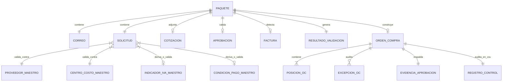
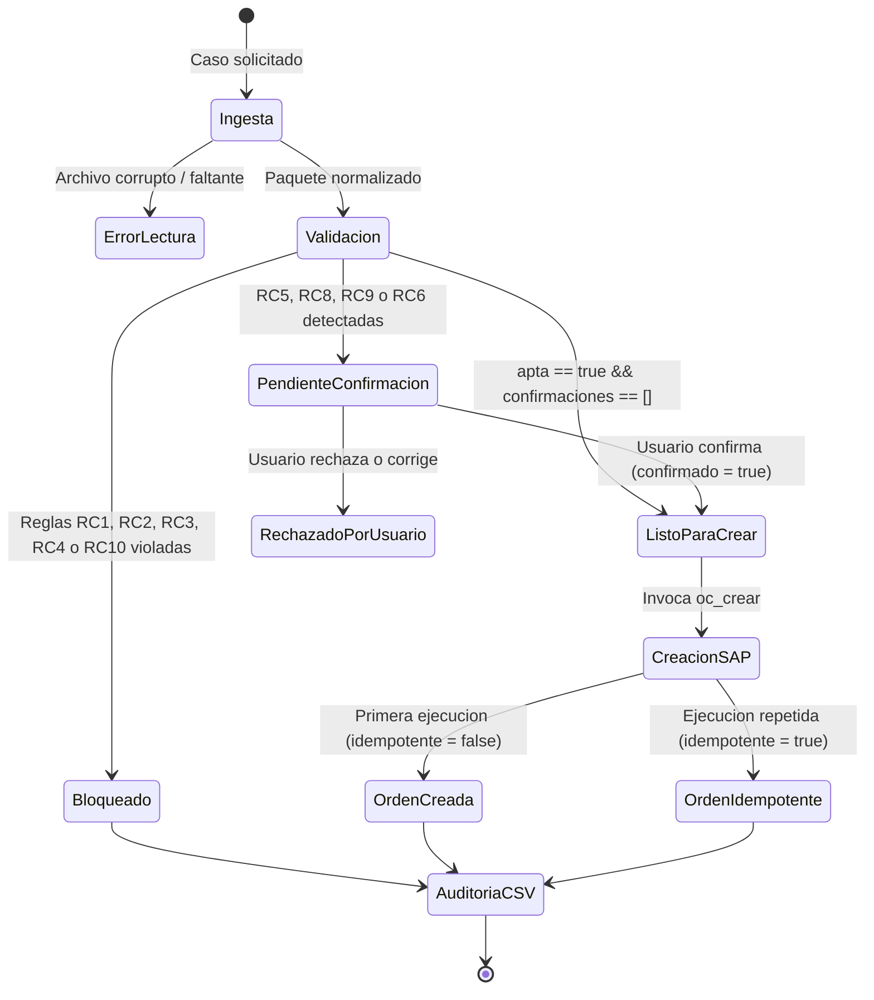

# Data Model: Agente Órdenes de Compra SAP

**Feature**: `specs/001-ordenes-compra-sap`  
**Date**: 2026-11-09  
**Status**: Completed  

---

## 1. Diagrama de Relación de Entidades

---

## 2. Definición Detallada de Entidades

### 2.1 Paquete y Componentes de Entrada

#### `Solicitud`
Representa el formulario inicial de compra diligenciado en la organización.
- **Campos**:
  - `solicitud_id` (string, PK): Identificador único (ej. `SOL-2026-001`).
  - `solicitante` (string): Nombre del empleado que solicita.
  - `proveedor_nombre` (string): Nombre o razón social del proveedor.
  - `proveedor_nit` (string, opcional): NIT tributario sin dígito de verificación.
  - `descripcion` (string): Detalle amplio de los bienes o servicios requeridos.
  - `centro_costo` (string, FK): Código del centro de costo (ej. `CC-1010`).
  - `subarea` (string): Subárea solicitante dentro del centro.
  - `cantidad` (number): Unidades requeridas (> 0).
  - `valor_unitario` (number): Precio por unidad (>= 0).
  - `valor_total` (number): Monto total de la solicitud (> 0).
  - `moneda` (enum: "COP" | "USD"): Moneda de cotización.
  - `indicador_iva` (string, opcional): Código tributario SAP (ej. `C1`).
  - `condiciones_pago` (string, opcional): Código de plazo de pago (ej. `Z030`).
  - `fecha_solicitud` (string): Fecha en formato ISO `YYYY-MM-DD`.

#### `Cotizacion`
Representa la propuesta económica formal emitida por el proveedor.
- **Campos**:
  - `proveedor` (string): Nombre del emisor de la cotización.
  - `nit` (string, nullable): NIT extraído de la cotización.
  - `total` (number): Valor monetario total ofertado (incluye impuestos).
  - `moneda` (string): Moneda de la cotización.
  - `validez_hasta` (string, nullable): Fecha límite de vigencia.
  - `texto` (string): Contenido textual íntegro para trazabilidad.

#### `Aprobacion`
Representa la confirmación formal del gasto por parte del líder facultado.
- **Campos**:
  - `de` (string, email): Correo corporativo del remitente.
  - `fecha` (string, ISO): Timestamp del correo de aprobación.
  - `aprobado` (boolean): `true` si el cuerpo contiene "Aprobado".
  - `texto` (string): Contenido íntegro del correo.

#### `Factura` (Solo en escenarios retroactivos)
- **Campos**:
  - `numero` (string): Número fiscal de la factura comercial.
  - `fecha` (string, ISO `YYYY-MM-DD`): Fecha de emisión fiscal.
  - `total` (number): Monto total facturado.

#### `Paquete`
Agregación raíz que consolida las entidades anteriores:
- `correo`: `{ id: string, de: string, asunto: string, fecha: string }`
- `solicitud`: `Solicitud`
- `cotizacion`: `Cotizacion | null`
- `aprobacion`: `Aprobacion | null`
- `factura`: `Factura | null`

---

### 2.2 Entidades Maestras (Solo Lectura)

#### `MaestroProveedor` (`fixtures/.../maestros/proveedores.json`)
- `codigo_sap` (string, PK): Identificador maestro en SAP (ej. `"100234"`).
- `nit` (string, UK): NIT numérico.
- `nombre` (string): Razón social.
- `condiciones_pago_default` (string): Código de pago por defecto (ej. `"Z030"`).
- `indicador_iva_default` (string): Código de IVA por defecto (ej. `"C1"`).
- `activo` (boolean): Bandera de vigencia comercial.

#### `MaestroCentroCosto` (`fixtures/.../maestros/centros-costo.json`)
- `centro_costo` (string, PK): Código del centro (ej. `"CC-1010"`).
- `nombre` (string): Nombre del centro (ej. `"Tecnología"`).
- `subareas` (string[]): Subáreas válidas (ej. `["Infraestructura", "Soporte", "Desarrollo"]`).
- `aprobadores`: Lista de `{ email: string, nombre: string, tope: number }`.

#### `MaestroIndicadorIVA` (`fixtures/.../maestros/indicadores-iva.json`)
- `codigo` (string, PK): `"C0" | "C1" | "C2"`.
- `descripcion` (string): Descripción de la tasa.
- `tasa` (number): Factor numérico (`0`, `0.19`, `0.05`).

#### `MaestroCondicionPago` (`fixtures/.../maestros/condiciones-pago.json`)
- `codigo` (string, PK): `"Z000" | "Z015" | "Z030" | "Z060"`.
- `descripcion` (string): Detalle comercial.
- `dias` (number): Días calendario de crédito (`0`, `15`, `30`, `60`).

---

### 2.3 Entidades de Procesamiento y Salida

#### `ResultadoValidacion`
Resultado generado por `oc_validar`:
- `apta` (boolean): `true` si no existen violaciones de reglas bloqueantes.
- `bloqueos` (string[]): Códigos y descripciones de violaciones graves (RC1, RC2, RC3, RC4, RC10).
- `confirmaciones` (string[]): Alertas que exigen aprobación humana (RC5, RC8, RC9, RC6).
- `derivados` (Record<string, unknown>): Valores autocompletados desde maestros (RC6, RC7).
- `retroactiva` (boolean): `true` si se detecta factura emitida antes de la solicitud (RC8).

#### `OrdenCompra` (Payload SAP - Sección 7.4)
- `referencia`: `{ solicitud_id: string, correo_id: string, cotizacion_ref: string | null }`
- `sociedad`: `"1000"` (constante SAP)
- `organizacion_compras`: `"1000"` (constante SAP)
- `proveedor`: `{ codigo_sap: string, nit: string, nombre: string }`
- `moneda`: `"COP" | "USD"`
- `condiciones_pago`: string (código SAP)
- `aprobador`: `{ email: string, fecha_aprobacion: string, evidencia_sha256: string }`
- `posiciones`: Array de:
  - `numero`: number (10, 20, 30...)
  - `descripcion`: string (máximo 40 caracteres)
  - `cantidad`: number
  - `unidad`: `"UN" | "H" | "MES"`
  - `precio_unitario`: number
  - `centro_costo`: string
  - `subarea`: string
  - `indicador_iva`: string
- `excepciones`: Array de:
  - `codigo`: string (ej. `"RC5"`, `"RC8"`)
  - `detalle`: string
  - `confirmado_por`: string | null

#### `RegistroControl` (Fila en `out/control.csv`)
- `solicitud_id`: string
- `resultado`: `"CREADA" | "BLOQUEADA" | "PENDIENTE_CONFIRMACION"`
- `numero_oc`: string | "" (número SAP asignado o vacío)
- `retroactiva`: boolean (`true | false`)
- `bloqueos`: string (códigos concatenados con `;`)
- `confirmaciones`: string (códigos concatenados con `;`)
- `ts`: string (ISO 8601 timestamp)

---

## 3. Máquina de Estados del Procesamiento

