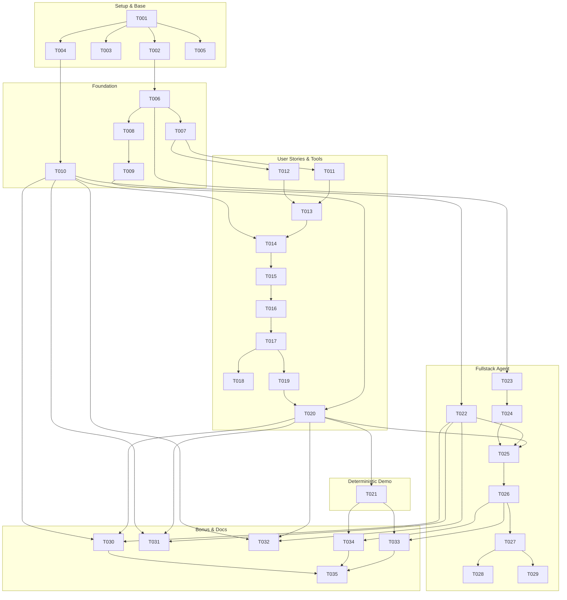

# Tasks: Agente Conversacional Órdenes de Compra SAP

**Input**: Design documents from `specs/001-ordenes-compra-sap/` (`spec.md`, `plan.md`, `research.md`, `data-model.md`, `contracts/`, `quickstart.md`)  
**Prerequisites**: `plan.md` (approved), `spec.md` (approved)  
**Organization**: Tasks organized by Setup, Foundation, User Stories (US1 - US6), Fullstack Agent Chat & Bonus Modular, and Final Documentation Deliverables.

---

## Format: `[ID] [P?] [Story] Description`

- **[P]**: Ejecución en paralelo permitida (archivos distintos sin dependencias directas).
- **[Story]**: Historia de usuario vinculada (US1 a US6, o Setup/Foundation/Chat/Doc).
- Rutas explícitas para cada tarea.

---

## Phase 1: Setup (Shared Infrastructure)

**Purpose**: Inicialización del proyecto TypeScript estricto, gestión de dependencias y configuración base.

- [X] T001 Inicializar `package.json` con scripts (`dev`, `start`, `demo`, `build`, `typecheck`), dependencias core (`zod`, `pdf-lib`, `@google/genai`) y devDependencies (`typescript`, `@types/node`, `tsx`).
- [X] T002 Configurar `tsconfig.json` con modo estricto (`strict: true`, `noImplicitAny: true`, `target: ES2022`, `moduleResolution: NodeNext`) garantizando el Principio I de la Constitución.
- [X] T003 [P] Crear `.env.example` documentando `GEMINI_API_KEY` (o proveedor elegido) y variables de puerto sin valores reales ni secretos.
- [X] T004 [P] Crear estructura base de directorios requerida (`src/types/`, `src/schemas/`, `src/sap/`, `src/tools/`, `src/llm/`, `src/agent/`, `src/knowledge/`, `web/`, `agent/`, `modulo/`, `out/`).
- [X] T005 [P] Configurar `.gitignore` para ignorar `.env`, `node_modules/`, `out/` y archivos temporales de compilación.

---

## Phase 2: Foundational (Blocking Prerequisites)

**Purpose**: Infraestructura de tipado, esquemas de validación Zod y adaptador simulado de SAP que desbloquean todas las historias de usuario.

- [X] T006 [P] Definir tipos e interfaces TypeScript del dominio en `src/types/oc.ts` (`Solicitud`, `Cotizacion`, `Aprobacion`, `Factura`, `Paquete`, `OrdenCompra`, `PosicionOC`, `ResultadoValidacion`, `MaestroProveedor`, `MaestroCentroCosto`).
- [X] T007 [P] Implementar esquemas declarativos Zod en `src/schemas/oc.ts` (`SolicitudSchema`, `CotizacionSchema`, `AprobacionSchema`, `FacturaSchema`, `PaqueteSchema`, `PosicionOrdenCompraSchema`, `ExcepcionOrdenCompraSchema`, `OrdenCompraSchema`).
- [X] T008 Definir la interfaz estricta de integración SAP en `src/sap/adapter.ts` (`consultarProveedor`, `crearOrden`, `buscarOrdenPorReferencia`) conforme a la sección 7.4 del PRD.
- [X] T009 Implementar el adaptador SAP simulado en `src/sap/mock.ts` que persiste órdenes en `out/sap/ordenes.jsonl`, mantiene el correlativo secuencial desde `4500000001`, implementa búsqueda de idempotencia por `solicitud_id` y registra en `out/control.csv`.
- [X] T010 [P] Crear base de conocimiento del proceso en `src/knowledge/ordenes-compra.md` documentando las reglas de negocio, catálogos maestros, matrices de aprobación y códigos SAP para consulta del agente.

**Checkpoint**: Base de datos, tipos y adaptador SAP listos. Comienza la implementación de herramientas y flujos de historias de usuario.

---

## Phase 3: User Story 1 - Lectura y Normalización de Paquetes (Priority: P1) 🎯 MVP

**Goal**: Ingestar y estructurar el paquete de documentos de cualquier caso (`correo.json`, `solicitud.json`, `cotizacion.txt`, `aprobacion.json`, `factura.txt`) retornando el objeto `Paquete` normalizado.

**Independent Test**: Invocar `oc_leer_paquete` para `sol-001` y validar que devuelva `{ ok: true, data: Paquete }` con datos parseados correctamente desde rutas relativas a `ctx.directory`.

- [X] T011 [US1] Implementar parser determinista de cotizaciones en texto (`cotizacion.txt`) extrayendo proveedor, NIT, total, moneda y validez dentro de `src/tools/oc.ts`.
- [X] T012 [US1] Implementar parser de correos de aprobación (`aprobacion.json`) evaluando si el cuerpo contiene "Aprobado" (case-insensitive) dentro de `src/tools/oc.ts`.
- [X] T013 [US1] Implementar la herramienta `leer_paquete` (`oc_leer_paquete`) en `src/tools/oc.ts` validando entradas con Zod, resolviendo rutas relativas a `ctx.directory`, capturando errores y retornando JSON `{ ok, data }` o `{ ok, error }`.

**Checkpoint**: US1 completada y testeable de manera autónoma.

---

## Phase 4: User Story 2 - Validación Determinista contra Maestros y Reglas de Control (Priority: P1)

**Goal**: Aplicar de forma exhaustiva las 10 reglas de control (RC1 a RC10) detectando bloqueos y determinando si una solicitud es apta para procesarse en SAP.

**Independent Test**: Ejecutar validación sobre `sol-002` (bloqueo RC1 por proveedor inexistente) y `sol-003` (bloqueo RC2 y RC3 por aprobador indebido / tope superado), comprobando `apta: false`.

- [X] T014 [US2] Implementar cargador de catálogos maestros en `src/tools/oc.ts` (`fixtures/.../maestros/` para proveedores, centros de costo, indicadores de IVA y condiciones de pago) resueltos relativamente a `ctx.directory`.
- [X] T015 [US2] Implementar motor de validación de reglas bloqueantes en `src/tools/oc.ts`:
  - `RC1`: Validación de existencia y estado activo de proveedor (por NIT o nombre normalizado).
  - `RC2`: Validación de aprobación existente, texto "Aprobado" y remitente en aprobadores del centro de costo.
  - `RC3`: Validación de monto total $\le$ tope del aprobador para el centro de costos.
  - `RC4`: Validación de pertenencia de subárea al centro de costo.
  - `RC10`: Validación de coherencia matemática `cantidad × valor_unitario` igual a `valor_total` ($\pm 1$).

**Checkpoint**: US2 bloquea automáticamente cualquier paquete no conforme antes de tocar SAP.

---

## Phase 5: User Story 3 - Gestión de Excepciones, Confirmaciones Humanas y Derivados (Priority: P2)

**Goal**: Detectar discrepancias de cotización, ausencia de IVA, facturas retroactivas y derivar automáticamente valores por defecto desde los maestros.

**Independent Test**: Validar `sol-004` (desvío 6% de cotización), `sol-005` (factura anterior a solicitud con `retroactiva: true`) y `sol-006` (derivación de IVA y condiciones de pago).

- [X] T016 [US3] Implementar evaluación de reglas de confirmación y derivación en `src/tools/oc.ts`:
  - `RC5`: Cálculo de discrepancia porcentual cotización vs. solicitud ($> 2\%$ o cotización ausente) solicitando confirmación con ambos montos.
  - `RC6`: Detección de indicador de IVA ausente, derivando `indicador_iva_default` del maestro y requiriendo confirmación.
  - `RC7`: Detección de condiciones de pago ausentes, derivando `condiciones_pago_default` del proveedor e informando sin bloquear.
  - `RC8`: Detección de fecha de factura anterior a la fecha de la solicitud, marcando `retroactiva = true` y requiriendo confirmación.
  - `RC9`: Verificación de fecha de aprobación $\ge$ fecha de solicitud.
- [X] T017 [US3] Integrar la herramienta `validar` (`oc_validar`) en `src/tools/oc.ts` consolidando `{ apta, bloqueos, confirmaciones, derivados, retroactiva }` retornando JSON serializado a prueba de excepciones.

**Checkpoint**: Reglas RC1 a RC10 completamente funcionales y catalogadas en Bloqueos, Confirmaciones y Derivados.

---

## Phase 6: User Story 4 - Generación de Evidencia de Aprobación y Trazabilidad (Priority: P2)

**Goal**: Crear el comprobante documental del correo de aprobación con cálculo de hash SHA-256 y generar el payload de la OC con mapa de trazabilidad.

**Independent Test**: Ejecutar `oc_generar_evidencia` en `sol-001` y validar que cree `out/sol-001/aprobacion.txt` (y `.pdf`) con hash SHA-256 válido; ejecutar `oc_construir_payload` y validar `out/sol-001/trazabilidad.json`.

- [X] T018 [US4] Implementar la herramienta `generar_evidencia` (`oc_generar_evidencia`) en `src/tools/oc.ts` para crear `out/<caso>/aprobacion.txt` con encabezados normalizados, cuerpo del correo y cálculo de hash criptográfico SHA-256; y generación de `aprobacion.pdf` mediante `pdf-lib` (P1).
- [X] T019 [US4] Implementar la herramienta `construir_payload` (`oc_construir_payload`) en `src/tools/oc.ts` mapeando campos de la solicitud, cotización y derivados al esquema `OrdenCompraSchema`, truncando descripciones a 40 caracteres, inyectando el hash de evidencia y persistiendo `out/<caso>/trazabilidad.json`.

**Checkpoint**: Evidencias de auditoría inmutables y payloads estructurados listos para SAP.

---

## Phase 7: User Story 5 - Creación de la Orden en SAP Simulado, Idempotencia y Auditoría (Priority: P1)

**Goal**: Crear órdenes en SAP simulado asegurando idempotencia ante reintentos y registrando cada intento en `out/control.csv`.

**Independent Test**: Invocar `oc_crear` en `sol-001` dos veces y verificar que la segunda devuelva el mismo número de orden con `idempotente: true` sin duplicar filas en `ordenes.jsonl`.

- [X] T020 [US5] Implementar la herramienta `crear` (`oc_crear`) en `src/tools/oc.ts` conectada a `SapMockAdapter`:
  - Valida que `confirmaciones` esté vacío o que el flag `confirmado === true`.
  - Verifica si la orden ya existe en `out/sap/ordenes.jsonl` (idempotencia).
  - Si es nueva, genera consecutivo secuencial a partir de `4500000001` y la escribe en el archivo.
  - Registra fila de auditoría en `out/control.csv` con estado (`CREADA`, `BLOQUEADA`, `IDEMPOTENTE`), número de OC y bandera de retroactividad.

**Checkpoint**: Ciclo determinista completo de herramientas finalizado.

---

## Phase 8: User Story 6 - Verificación Determinista sin Modelo (`demo.ts`) (Priority: P1)

**Goal**: Ejecutar los 6 casos de prueba (`sol-001` a `sol-006`) directamente sobre las herramientas sin dependencias de LLM ni tokens externos.

**Independent Test**: Ejecutar `bun run demo.ts` o `npx tsx demo.ts` en consola y verificar que procese todos los casos, pruebe la idempotencia de `sol-001` y la confirmación explícita de `sol-004`.

- [X] T021 [US6] Implementar el script determinista `demo.ts` en la raíz del proyecto:
  - Limpia o inicializa el directorio `out/` al arrancar.
  - Procesa `sol-001` exitosamente (creación de orden `4500000001`).
  - Procesa `sol-001` una segunda vez demostrando idempotencia (`idempotente: true`).
  - Procesa `sol-002` demostrando bloqueo RC1 (proveedor inexistente).
  - Procesa `sol-003` demostrando bloqueos RC2 y RC3 (aprobador no autorizado y tope excedido).
  - Procesa `sol-004` demostrando detección de desvío RC5, ejecución de confirmación y creación subsecuente.
  - Procesa `sol-005` demostrando detección retroactiva RC8, confirmación y registro en `out/control.csv` con `retroactiva: true`.
  - Procesa `sol-006` demostrando derivación de IVA RC6 y condiciones de pago RC7.
  - Imprime tabla consolidada legible de resultados en consola y finaliza con código de salida 0.

**Checkpoint**: `demo.ts` listo para ser evaluado sin claves de LLM.

---

## Phase 9: Agente Conversacional Completo, Adaptador LLM y Frontend de Chat

**Purpose**: Integrar el ciclo conversacional del agente con el modelo de lenguaje, frontend interactivo y endpoints HTTP.

- [X] T022 [P] Redactar el System Prompt del agente en `agent/prompt.md` definiendo personalidad, reglas de negocio, directivas estrictas para no inventar datos no originados en herramientas, límite de 25 iteraciones y protocolo de solicitud de confirmación humana (Sección 6.3 del PRD).
- [X] T023 [P] Implementar la interfaz agnóstica de proveedor LLM en `src/llm/adapter.ts` (`LlmAdapter`).
- [X] T024 Implementar el proveedor de modelo de lenguaje en `src/llm/provider.ts` (con Google Gemini SDK `@google/genai` o adaptador compatible), aislando la API key en `process.env.GEMINI_API_KEY` con control de timeouts y mapeo de tool calls.
- [X] T025 Implementar el orquestador del ciclo del agente en `src/agent/runner.ts` manejando el bucle conversacional (prompt → LLM → tool execution en `src/tools/oc.ts` → LLM → respuesta), tope de iteraciones por turno, persistencia de sesiones en memoria y detección de necesidad de confirmación.
- [X] T026 Implementar el servidor HTTP en `src/server.ts` exponiendo los endpoints `/api/chat` (POST), `/api/sessions/:id` (GET), `/api/health` (GET) y sirviendo los archivos estáticos de la carpeta `web/`.
- [X] T027 [P] Desarrollar la interfaz web de chat en `web/index.html` con historial de conversación, visualización destacada de llamadas a herramientas (nombre, argumentos, respuesta resumida) y panel/botón de confirmación humana cuando el agente lo solicite.
- [X] T028 [P] Crear los estilos de la interfaz en `web/style.css` proporcionando un diseño moderno, responsivo y profesional.
- [X] T029 Implementar la lógica cliente en `web/app.ts` (o `web/app.js`) para interactuar con la API `/api/chat`, renderizar tool calls en tiempo real y gestionar respuestas de confirmación.

**Checkpoint**: Agente conversacional interactivo completamente operativo en navegador web.

---

## Phase 10: Bonus de Modularidad (`modulo/`) (+10 Puntos)

**Purpose**: Empaquetar el agente como un módulo desacoplado e independiente listo para integrarse en otras plataformas de agentes según la sección 9.4 del PRD.

- [X] T030 Crear `modulo/agent.md` con frontmatter YAML (`description`, `mode: primary`, `permission: { edit: deny, bash: deny }`) y cuerpo idéntico a `agent/prompt.md`.
- [X] T031 Copiar/enlazar las herramientas en `modulo/tools/oc.ts` garantizando que sean exactamente las mismas de `src/tools/oc.ts` y puedan importarse de forma autónoma sin el servidor.
- [X] T032 Crear `modulo/skill/ordenes-compra/SKILL.md` con frontmatter YAML (`name: ordenes-compra`, `description: Conocimiento de negocio y reglas de validación de órdenes de compra SAP`) y cuerpo con el conocimiento íntegro del proceso de `src/knowledge/ordenes-compra.md`.

**Checkpoint**: Módulo reutilizable verificado y alineado con la aplicación principal.

---

## Phase 11: Documentación Obligatoria y Entrega Final

**Purpose**: Completar la documentación técnica rigurosa exigida para la evaluación del reto técnico.

- [X] T033 Redactar `SOLUCION.md` cumpliendo con las 12 secciones obligatorias de la sección 9.1 del PRD:
  1. Problema en una frase y a quién le duele.
  2. Arquitectura (diagrama front → backend → herramientas → archivos, separación prompt / conocimiento / ejecución).
  3. Ciclo del agente (bucle, tope de iteraciones, confirmación humana).
  4. Elección del modelo (proveedor, modelo, justificación y costo estimado por caso).
  5. Matriz de controles (implementación de RC1 a RC10 y análisis de la más difícil).
  6. Diseño del adaptador SAP real (sección 7.5: OData vs BAPI vs Integration Suite, mapeo, seguridad, idempotencia, Plan B sin conexión).
  7. Lectura del proceso (análisis ejecutivo de media página para la dirección sobre OC retroactivas y propuesta de cambio de proceso).
  8. Decisiones y trade-offs (mínimo 3 con alternativas descartadas y motivos).
  9. Supuestos asumidos.
  10. Cobertura de historias de usuario (tabla con estado y pendientes para producción).
  11. Uso de IA (asistentes utilizados, tareas, descartes y justificación).
  12. Riesgos de producción y mitigaciones.
- [X] T034 Redactar `README.md` detallando requisitos, comando único para levantar en local (`bun run dev` o `npm run dev`), instrucciones para ejecutar `demo.ts`, enlace de prueba pública y credenciales si aplican.
- [X] T035 [P] Ejecutar verificación final integral: typecheck estricto de TypeScript (`bun run typecheck` o `npx tsc --noEmit`), ejecución de `demo.ts` y revisión de que no existan secretos ni rutas absolutas en el repositorio.

---

## Dependencies & Execution Order

---

## Implementation Strategy

### MVP First (demo.ts y Capa de Herramientas)
1. Completar Setup (T001 - T005) y Foundation (T006 - T010).
2. Implementar herramientas deterministas `src/tools/oc.ts` (T011 - T020).
3. Construir y verificar `demo.ts` (T021) procesando los 6 casos de prueba con idempotencia y retroactividad.
4. **Validación**: `demo.ts` corre y valida el 100% de la lógica sin LLM.

### Segunda Entrega (Agente Conversacional y UI)
1. Desarrollar prompt de sistema en `agent/prompt.md` y adaptador LLM en `src/llm/` (T022 - T024).
2. Construir el orquestador conversacional en `src/agent/runner.ts` y servidor HTTP en `src/server.ts` (T025 - T026).
3. Implementar frontend de chat en `web/` con visualización de llamadas a herramientas y confirmaciones (T027 - T029).

### Tercera Entrega (Bonus Modular y Documentación Rúbrica 100/100)
1. Empaquetar módulo reutilizable en `modulo/` (T030 - T032).
2. Redactar `SOLUCION.md` con las 12 secciones exhaustivas y `README.md` (T033 - T034).
3. Verificación final de tipo estricto y limpieza de artefactos (T035).

